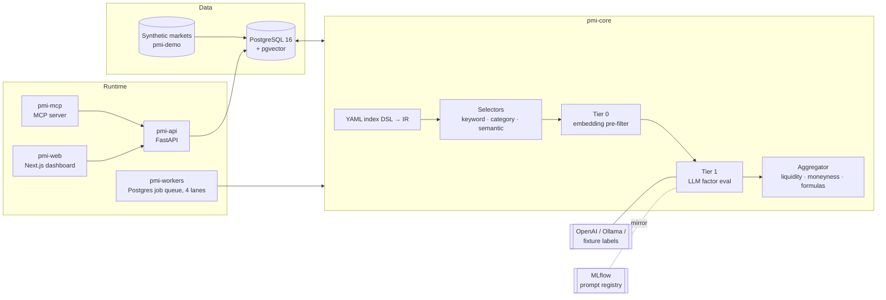

# PMI Platform

[](https://github.com/chen82508/pmi-platform/actions/workflows/ci.yml)

A platform for building **Prediction Market Indices (PMIs)**: single numbers
that summarise what many prediction-market contracts are pricing about one
topic, such as geopolitical conflict risk, seats in the 2026 US Senate, or
whether Bitcoin traders lean bullish.

Each index is a **declarative, versioned YAML definition**. The engine selects
candidate markets, has an LLM judge each market against the index's factors,
weights the results by liquidity and relevance, and aggregates them into a
score. Every score can be traced back to the exact definition, prompt, model
and market prices that produced it.

> **About this repository.** This platform was built by a small team at a
> prediction-market startup in 2026 and ran in production on AWS until the
> project was wound down. This is a cleaned-up snapshot prepared as a
> portfolio piece. Live exchange ingestion, the public marketing site and
> internal operations tooling were removed (see [What was removed](#what-was-removed)),
> so the stack runs end-to-end on bundled fixture markets. The infrastructure
> as code and CI in this repository were added in that cleanup.

---

## Architecture



| Package | Role |
|---|---|
| [`pmi-core`](pmi-core/) | Engine and shared schema: DSL parser, selectors, LLM factor evaluation, aggregation formulas, backtests, Alembic migrations, the Postgres job queue, and the classification eval harness |
| [`pmi-workers`](pmi-workers/) | Cron-to-queue scheduler plus the queue consumers, split into four lanes (`default`, `snapshot`, `batch`, `long`) |
| [`pmi-api`](pmi-api/) | FastAPI service: scores, history, explainability, on-demand refresh, backtests, and a natural-language `/ask` endpoint |
| [`pmi-mcp`](pmi-mcp/) | [Model Context Protocol](https://modelcontextprotocol.io) server that exposes the indices to AI agents |
| [`pmi-web`](pmi-web/) | Next.js operational dashboard: index list, score history, refresh, backtest, source health |
| [`pmi-notify`](pmi-notify/) | Small Slack failure-notification library shared by the services |
| [`infra/terraform`](infra/terraform/) | AWS: VPC, EC2 host, CloudWatch alarms, and SNS → Lambda → Slack alerting |

## Design highlights

- **Indices are data, not code.** A definition declares selectors, LLM
  factors with weights, liquidity and moneyness weighting, and an aggregation
  formula. Changing an index means bumping its version. Definitions are stored
  as slowly changing dimension (SCD2) rows keyed by the YAML's sha256, so older
  versions keep scoring and stay comparable over time.
- **Reproducible LLM judgements.** Prompts are versioned markdown files
  (append-only, hash-locked). A model registry binds each factor to a prompt,
  model and temperature. Evaluations are immutable and cached on
  `(market, definition, prompt, model)`, so only new markets or changed
  conditions cost tokens. Each score row stores the ids of the evaluations it
  was built from.
- **Tiered evaluation.** A pgvector cosine pre-filter drops clearly irrelevant
  markets before any LLM call. Factor calls run concurrently under a per-tick
  budget and a circuit breaker. A deterministic stub evaluator keeps the
  pipeline runnable with no LLM at all.
- **Multiple aggregation formulas.** The engine supports weighted and signed
  averages, a Poisson-binomial seat projection with an optional Gaussian
  copula for correlated races, an entity-lean mean, a geography-weighted
  rollup, and log-moneyness kernels for price-ladder markets.
- **A queue without extra infrastructure.** Jobs live in a Postgres table and
  are claimed with `FOR UPDATE SKIP LOCKED`, woken with `LISTEN/NOTIFY`, and
  deduplicated with a partial unique index. Retries use backoff and stale
  claims are recovered. A step-checkpointed workflow table makes long
  backtests resumable. The queue has four lanes so that slow batch jobs
  cannot starve page-facing snapshots.
- **A guard against partial runs.** A tick that scores far fewer components
  than the recent median is held back instead of published. This came from
  a production incident where an index jumped 12 points and back in an hour
  without the market moving.
- **Measured classification quality.** The eval harness samples stratified
  gold sets, labels them with several models and structural rules, and reports
  precision and recall at the sample, population and liquidity-weighted
  levels. It found an index whose membership had silently fallen back to the
  stub evaluator after a factor rename.
- **Agent access.** The MCP server wraps the REST API in agent-friendly tools
  that return a `summary` plus a compacted `data` payload and structured
  errors. The `/ask` endpoint answers questions through the same tools.

## Quick start

The repository ships a small **synthetic market world** in place of the live
exchange feeds: 58 invented markets (conflict, a Bitcoin strike ladder, all 35
US Senate seats up in 2026), each with 14 days of price history and
pre-labelled factor judgements. A `fixture/` LLM provider replays those labels
through the same provider interface OpenAI and Ollama use, so model
resolution, evaluation records, the cache and every aggregation formula run
for real, with no API key and no GPU. See [`pmi-demo`](pmi-demo/).

### 1. Score an index in-process (no Docker, no database)

```bash
just venv          # uv venv + editable installs of every Python package
cd pmi-core && ../.venv/bin/python -m pmi_core.cli dry-run \
    pmi_core/index_defs/us-senate-2026-republican-seats.yaml --compact
#   "score": 52.035, "component_count": 35   ← projected Republican seats
```

### 2. Run the full stack

```bash
cp .env.example .env
just up            # postgres, mlflow, api, mcp, workers, dashboard
just bootstrap     # migrate → seed fixtures → bind fixture models → 14-day history
open http://localhost:3000
```

This publishes a 14-day series for three indices that use three different
formulas:

| Index | Formula | Fixture reading |
|---|---|---|
| Global War Index 2026 | geography-weighted rollup over countries and regions | 8.4 / 100 |
| BTC Bull/Bear | signed average with log-moneyness weighting of the strike ladder | 47.8 / 100 |
| US Senate 2026 Republican seats | Poisson-binomial seat projection with correlated races | 52.0 seats |

The in-process dry-run gives the same numbers. To score with a real model
instead, set `OPENAI_API_KEY` (or run `just ollama-up` and set
`PMI_ACTIVE_EMBEDDING_MODEL=ollama/nomic-embed-text` to turn on the semantic
selector and Tier 0), then rebind factors with `pmi-core models register` and
`pmi-core models promote`.

### 3. Tests

```bash
just test-db       # throwaway pgvector container on :55432
just test-all      # pytest for every Python package
just lint
just web-check     # typecheck, vitest, next build
just tf-check      # terraform fmt / init / validate
```

## Infrastructure and CI

[`infra/terraform`](infra/terraform/) provisions a single-host deployment:

- **Network:** a VPC with one public subnet. The only open port is HTTP 80.
  There is no SSH; operators use SSM Session Manager.
- **Host:** an EC2 instance with IMDSv2 required, an encrypted gp3 volume and
  an Elastic IP. It bootstraps Docker, the CloudWatch agent and the compose
  stack as a systemd unit.
- **Alarms:** CloudWatch alarms on CPU, memory, root disk, and the system and
  instance status checks. A failed system check triggers automatic EC2
  recovery. If the agent stops reporting, the memory and disk alarms fire.
- **Alerting:** every alarm goes to an SNS topic, and a Lambda posts it to
  Slack. The webhook URL lives in an SSM SecureString that Terraform creates
  but never reads, so the secret stays out of state.

See [`infra/terraform/README.md`](infra/terraform/README.md) for usage.

[GitHub Actions](.github/workflows/ci.yml) runs on every push and pull request:

| Job | Checks |
|---|---|
| `python (matrix)` | ruff and pytest for each Python package, against a pgvector service container; dry-run of every index definition |
| `fixture demo end-to-end` | migrate, seed, bind the fixture provider, tag races and score 14 days against a real Postgres; asserts every demo index published a full series and every evaluation went through the provider |
| `web` | `tsc`, vitest, `next build` |
| `terraform` | `fmt -check`, `validate`, tflint with the AWS ruleset |
| `slack notifier lambda` | ruff and pytest |
| `docker compose config` | the compose file resolves with every profile |

## What was removed

| Removed | Why |
|---|---|
| Exchange ingestion: pollers, WebSocket consumers, scrapers and on-chain indexers for Polymarket, Kalshi, Manifold, PredictIt, ForecastEx, Metaculus and others | Needs live exchange access and API credentials. The engine only reads `core_markets` and `ts_price_snapshots`, which the synthetic fixtures fill instead |
| The branded public website and its design assets | Company branding and marketing content. The operational dashboard remains |
| Labelled gold sets | Built from scraped exchange market data. The harness code remains |
| Internal tooling, runbooks, incident reports and data-archival jobs | Company-internal operations |

The fixtures cover three of the ten index definitions. The others (House,
governors, S&P 500 and so on) and a few API routes and worker jobs for
verticals that depended on the removed sources, such as sports and esports
boards, still run but return little or nothing on the fixture data.

## Repository layout

```
pmi-core/        engine, schema, migrations, prompts, index definitions
pmi-workers/     scheduler (supercronic → queue) + queue consumers
pmi-api/         REST API
pmi-mcp/         MCP server
pmi-web/         Next.js dashboard
pmi-notify/      Slack notification helper
pmi-demo/        fixture markets
mlflow/          MLflow server image
db/init/         Postgres first-boot SQL (extensions, mlflow database)
infra/terraform/ AWS infrastructure
```
